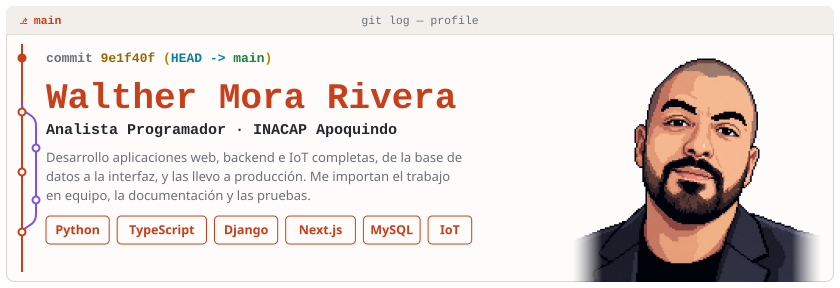
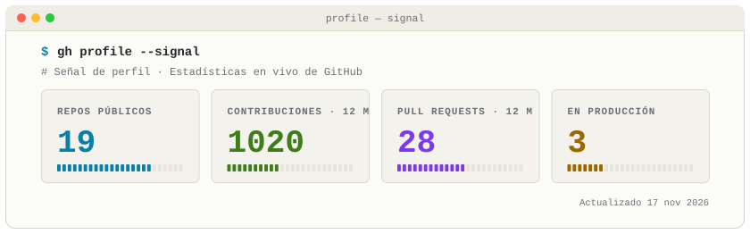
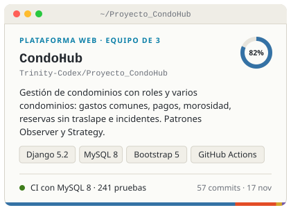
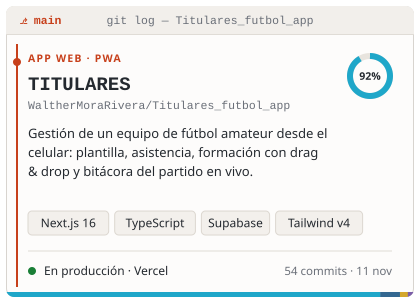
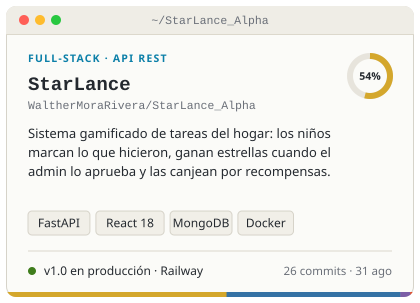
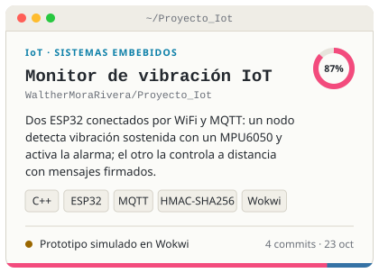
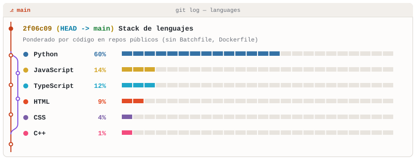
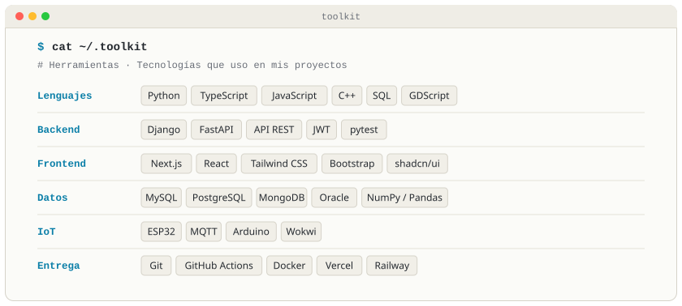
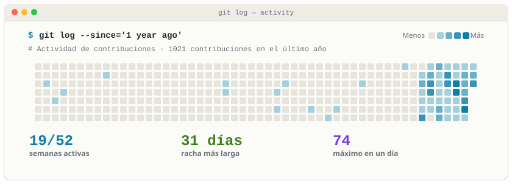

## Trabajo seleccionado

## Herramientas

## Señal de constancia

¿Quieres un perfil como este? Créalo con <a href="https://github.com/WaltherMoraRivera/github-profile-readme-generator">github-profile-readme-generator</a>.

Las tarjetas se generan con <a href="scripts/generate.py">scripts/generate.py</a> con datos de la API de GitHub.
